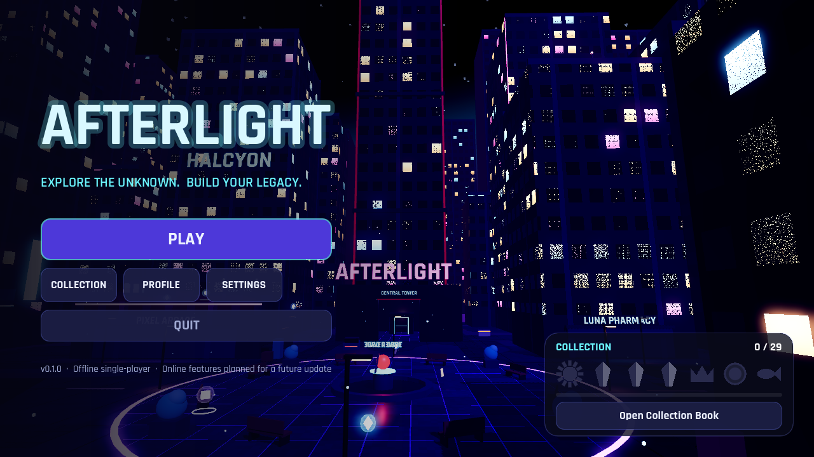
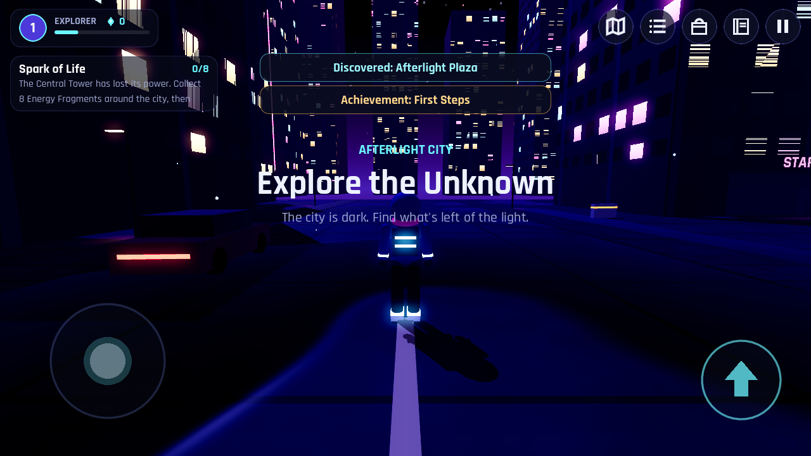
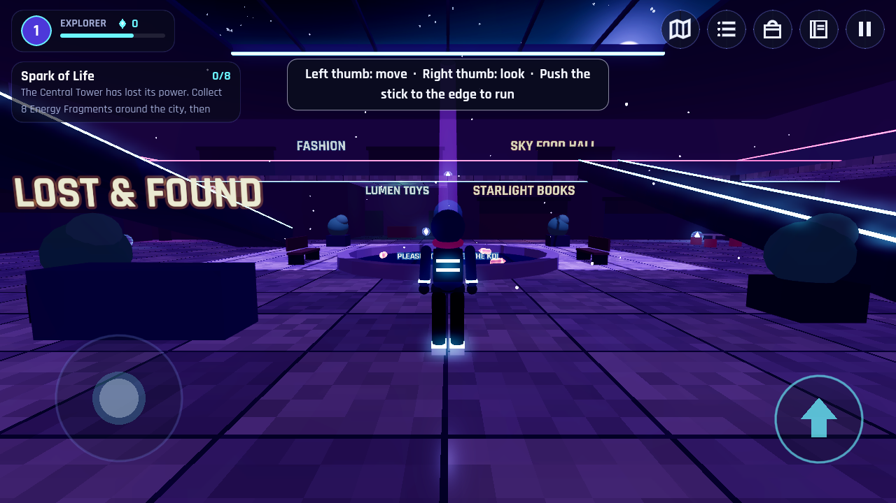
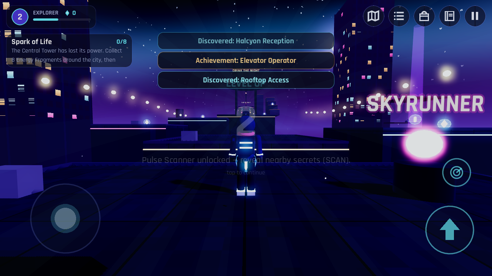
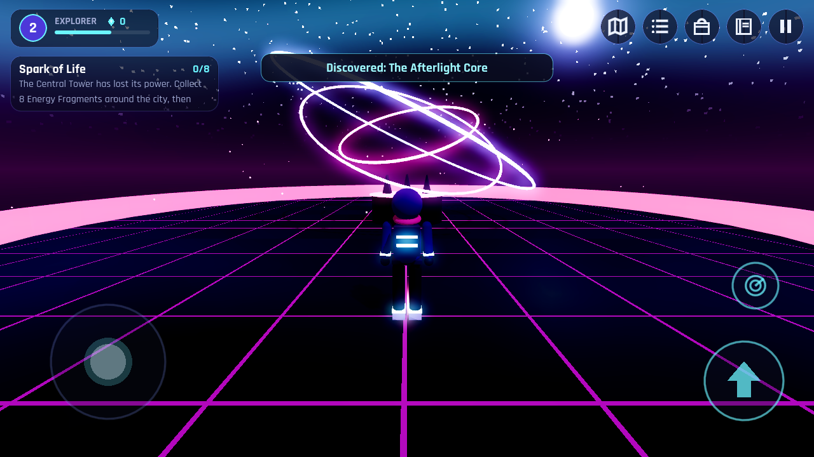
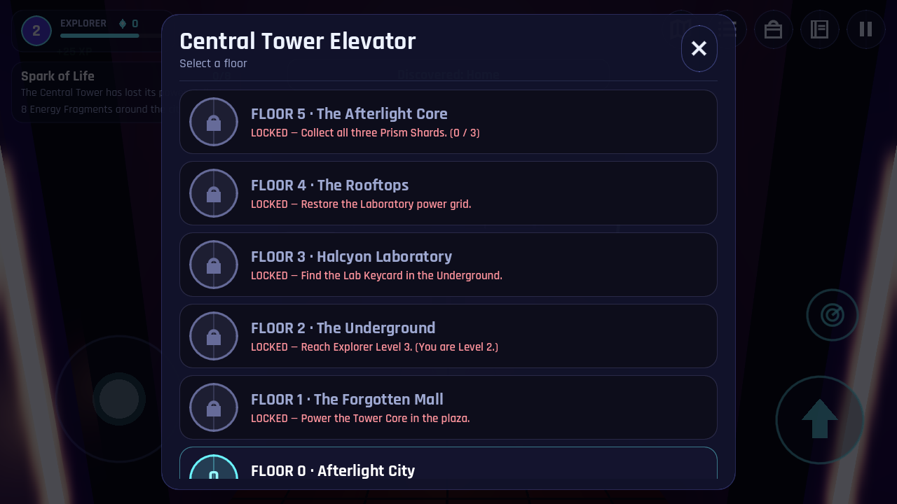
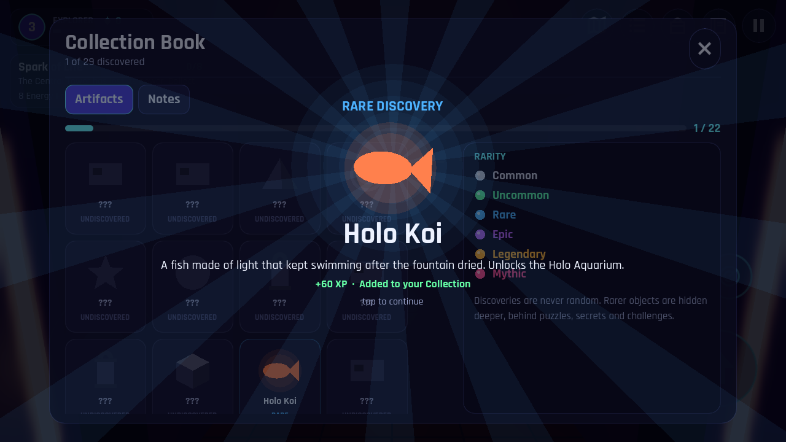

# AFTERLIGHT
**Explore the Unknown. Build Your Legacy.**

An original 3D exploration and discovery game for Android (and iOS), built with **Godot 4.3** and **GDScript**.
You wake in Afterlight City, a neon metropolis that looks abandoned. Restore the Central Tower, ride its elevator
to five strange floors, uncover secrets, complete challenges, collect 22 artifacts and 7 notes, decorate your
apartment, and awaken the light that remained after everyone left.



| | |
|---|---|
|  |  |
|  |  |
|  |  |

> Screenshots are rendered by `tests/screenshots.gd` with Mesa's *software* OpenGL renderer in a headless
> container, so they show the Compatibility renderer without GPU anti-aliasing. On a phone the game uses the
> Mobile renderer and looks cleaner.

---

## 1. Open and run

1. Install **Godot 4.3** or newer (standard build, *not* .NET): https://godotengine.org/download
2. In the Project Manager click **Import**, select `afterlight/project.godot`, then **Import & Edit**.
3. Press **F5** (Run Project).

The first import takes a few seconds while Godot imports the fonts and audio.

**Desktop controls**

| Action | Keyboard / mouse | Gamepad |
|---|---|---|
| Move | WASD / arrow keys | Left stick |
| Look | Mouse (click the game window to capture it) | Right stick |
| Run | Shift | L3 |
| Jump | Space | A |
| Interact | E or F | X |
| Pulse Scanner (Level 2+) | R | Y |
| Pause | Esc / P | Start |
| Inventory · Map · Missions · Collection | I/Tab · M · J · B | Back = Inventory |

**Touch controls** (switch on automatically on touch screens; you can force them under *Settings → Touch Controls*)
- Left thumb: floating joystick. Push it to the outer ring to **run**.
- Right thumb: drag to orbit the camera.
- Buttons: **Jump** (large), **Interact** (appears with its action, e.g. "READ NOTE"), **Scan** (Level 2+).
- The top-right icons open the Map, Missions, Inventory, Collection Book and Pause menu. Tap the objective card to open Missions.

## 2. Export an Android APK

The container this was built in has no Android SDK or export templates, so **no APK was compiled here**. The
project ships an Android export preset (`export_presets.cfg`) so exporting takes these steps:

1. **Editor → Manage Export Templates → Download and Install** (match your Godot version).
2. Install **OpenJDK 17** and the **Android SDK** (the easiest way is Android Studio, then *SDK Manager*:
   Platform-Tools, Build-Tools 34, Platform 34).
3. **Editor → Editor Settings → Export → Android**: set *Java SDK Path* and *Android SDK Path*.
   Godot 4.3 creates a debug keystore automatically. For a release build, create your own keystore:
   ```
   keytool -genkeypair -v -keystore afterlight-release.keystore -alias afterlight -keyalg RSA -keysize 2048 -validity 10000
   ```
   Enter it under *Project → Export → Android → Keystore → Release*. Keep the keystore out of git.
4. **Project → Export…**, choose the **Android** preset, then **Export Project** and save `afterlight.apk`.
   From the command line:
   ```
   godot --headless --path afterlight --export-debug "Android" export/afterlight.apk
   ```

The preset targets **arm64-v8a + armeabi-v7a**, landscape (sensor), immersive mode, and requests **no permissions**.

## 3. Install and test on a phone

1. On the phone, enable **Developer options → USB debugging**.
2. Connect it with USB and run `adb install -r export/afterlight.apk`, or copy the APK to the phone and open it
   (allow "install unknown apps").
3. To run straight from the editor, turn on **Debug → Deploy with Remote Debug** and click the Android icon
   (top right) while the phone is connected.

**iOS:** an iOS preset is included. Exporting needs macOS with Xcode and an Apple developer team ID
(*Project → Export → iOS → App Store Team ID*). The Mobile renderer and touch controls work on iOS too, but this
build has **not been tested on iOS hardware**.

## 4. Run the automated tests

```
cd afterlight
godot --headless --fixed-fps 60 res://tests/test_runner.tscn     # end-to-end gameplay test (110 checks)
godot --headless --fixed-fps 60 res://tests/traversal_bot.tscn   # proves every required jump works (24 checks)
xvfb-run godot --rendering-driver opengl3 res://tests/screenshots.tscn   # renders screenshots/
python3 tools/gen_audio.py                                        # regenerates all sound effects and music
```

`test_runner` plays the whole first chapter headlessly. It covers movement, jumping, pickups, the Tower Core,
every floor through the real elevator sequence, all three challenges, the secrets, the finale, the apartment,
every menu, the settings, and a save → reset → load cycle (including recovering from a corrupted save file).

---

## 5. The game

### Gameplay loop
Explore → collect Energy Fragments and artifacts → discover named places → finish missions → earn XP and
levels → unlock elevator floors and abilities → spend fragments on your apartment → explore further.

### Floors (inside the Central Tower's elevator)
| Floor | Area | How it unlocks | Highlights |
|---|---|---|---|
| 0 | **Afterlight City** | Start | Plaza with the Tower Core, the Central Tower, avenues, shops, the overpass, the arcade roof garden, Noodle Alley, the sealed subway |
| 1 | **The Forgotten Mall** | Power the Tower Core (8 fragments) | Two-level atrium, holographic koi, escalators, food court, hidden cinema, Staff Only corridor, the **Lost & Found** challenge |
| 2 | **The Underground** | Explorer Level 3 | Line 7 platform, the last train, maintenance tunnels, a candle-lit shrine, a bricked-up room. Your headlamp turns on |
| 3 | **Halcyon Laboratory** | Lab Keycard (found on Floor 2) | Reception, specimen hall, sealed cold storage, the **power-grid sequence puzzle**. Emergency lighting until you solve it |
| 4 | **The Rooftops** | Restore the lab's power grid | Rooftop chain above the city, the **Skyrunner** parkour run, a pigeon coop, a water-tower climb |
| 5 | **The Afterlight Core** | All three Prism Shards | The finale chamber and the Mythic discovery |
| APT | **Your Apartment** | Always | Decorations, display stands, home terminal, bed (save) |
| 6 | *Signal Lost* | Locked with the message "future update" (no content behind it) | — |

The elevator is a physical cab. You walk in and use its wall panel, the doors close, the cab hums and shakes,
the indicator counts, and the doors open on the new floor. Locked floors say exactly what they need, for
example "Reach Explorer Level 3. (You are Level 2.)".

### Discoveries
- **Rarity:** Common, Uncommon, Rare, Epic, Legendary, Mythic. Each has its own colour, XP value, glow and
  presentation. Rare and above get a cinematic card with light rays and a sound that grows with rarity.
- **22 collectibles + 7 lore notes.** Each has a name, a vector icon, a description, a rarity and a Collection
  Book entry. Undiscovered entries show as silhouettes. Some carry rewards: the Holo Koi unlocks the
  aquarium, the Cassette unlocks the record player, the Neon Crown and Silver Feather are wearable.
- **12 hidden locations** with no markers, including the Glyph Vault, Noodle Alley, the subway stairs, the
  roof garden, under the overpass, the cinema, the staff corridor, the shrine, the walled room, cold storage,
  the pigeon coop and the water tower.
- **Secrets that need work:** three neon glyphs that open a vault; a vending machine you push aside (a memo
  tells you where); loose bricks that hide the dusk shard; a lab puzzle whose clue is written on a note in
  another room; a water tower you must climb.
- Nothing depends on random luck. Every discovery is placed by hand.

### Challenges
1. **Lost & Found** (Mall): find 5 lost toys in 100 s. Reward: Lumi Plush (Rare).
2. **Grid Restart** (Lab): activate 4 consoles in the right order. A wrong console resets the sequence.
   Reward: opens Cold Storage (Stopped Clock, Epic) and Floor 4.
3. **Skyrunner** (Rooftops): reach the Summit antenna in 45 s without falling. Falling or running out of time
   fails the run. Reward: Compass of Elsewhere (Epic).

### Progression
- XP comes from fragments, discoveries, notes, places, missions and challenges.
- Levels unlock real things: Pulse Scanner (L2), the path to the Underground (L3), the arcade cabinet (L4),
  a **double jump** (L5), the Neon Trail (L6) and the Fragment Magnet (L8).
- **16 missions:** 7 main, 4 side, 2 exploration, 3 collection. Each shows its progress and reward, and you
  can pick which one to track.
- **12 achievements** and a profile page with statistics.

### Personal apartment
10 decorations that you unlock with fragments, levels or found items, then place or remove. There are 5
display stands for your artifacts, a home terminal and a bed that saves the game.

### Audio
All audio is original and synthesized by `tools/gen_audio.py`: the music theme, city and cave ambience,
footsteps, jump and landing, pickups, rarity fanfares, the elevator hum and ding, doors, UI sounds, puzzle
sounds and the level-up sound. *Settings* has Master, Music and SFX volume sliders.

### Saving
- JSON in `user://afterlight_save.json` with a `version` field and a `migrate()` hook for future formats.
- Atomic writes: the game writes a temp file, checks it, keeps the previous save as `.bak`, then renames.
  If the main file is corrupted, the game loads the backup.
- Saves after every meaningful event (debounced), every 45 s, after each elevator ride, and when the app is
  backgrounded, paused or closed. The bed in your apartment saves on demand.
- Settings are saved separately in `user://settings.cfg`.

### Mobile performance
- Mobile renderer. Only one floor is in memory at a time.
- **Low / Medium / High** presets: 70 / 85 / 100 % render scale, glow and shadows off or on, FXAA/MSAA,
  particle budget 40 / 80 / 100 %, camera far plane, 45 or 60 FPS cap.
- The building facades are one procedural shader (no window geometry or textures). Distant windows blend
  to an average colour.
- Shared, cached materials. Small props fade out at distance (visibility ranges). Few real lights, no
  per-light shadows, and fake neon "puddle" reflections instead of screen-space reflections.

---

## 6. Project structure

```
afterlight/
├── project.godot            engine config, autoloads, mobile renderer, landscape
├── export_presets.cfg       Android + iOS presets
├── scenes/main/             main_menu.tscn, game.tscn (thin scene roots)
├── scenes/                  (floors and UI are built from code, see scripts/)
├── scripts/
│   ├── autoload/            Events (signal bus), Settings, Progression, Inventory, WorldState,
│   │                        Missions, SaveSystem, Audio, Router (transitions + loading screen)
│   ├── core/                GameDB (all content data), Game (floors + elevator travel),
│   │                        InputSetup / InputState (keyboard, gamepad, touch)
│   ├── player/              Player (movement), PlayerModel (body + procedural animation), CameraRig
│   ├── world/               FloorBase (builder helpers), Mats (material cache), FX, floors/*.gd
│   ├── interact/            Interactable, Elevator, SlidingDoor, EnergyFragment, CollectiblePickup, DiscoveryZone
│   ├── puzzles/             SequencePuzzle, ParkourChallenge, HiddenObjectChallenge
│   └── ui/                  UIKit (theme), HUD, TouchControls, DiscoveryPopup, IconDraw, panels/*.gd
├── assets/
│   ├── audio/               synthesized WAVs
│   ├── fonts/               Rajdhani (SIL Open Font License, see OFL-Rajdhani.txt)
│   └── shaders/             building facade, night sky, wet ground, tiles, hologram, light beam
├── tests/                   test_runner, traversal_bot, screenshots
└── tools/gen_audio.py       original sound generator
```

**Architecture notes (multiplayer-ready).** Content data (`GameDB`) is separate from runtime state. Per-player
state (`Progression`, `Inventory`) is separate from world state (`WorldState`). Missions are *derived* from
state, never incremented by hand, so they can't fall out of sync. Systems talk through the `Events` signal
bus, which could be mirrored over the network later. Every system has `to_dict()` / `from_dict()`, ready
for server sync. Online features (friends, visits, trading, shared exploration) are **not implemented**, and
the game says so where it matters (pause menu, profile, main menu).

---

## 7. Status

### Implemented
Main menu with a live 3D city background · loading screen with tips · 3D player with procedural
idle/walk/run/jump/fall/land animation · smooth collision-aware camera · touch, keyboard, mouse and gamepad
controls · 5 floors + apartment + finale · physical elevator · 22 collectibles + 7 notes with rarity ·
12 hidden locations · 3 challenges · 16 missions · levels with ability unlocks · 12 achievements · inventory
with cosmetics · collection book · map · profile · settings · personal room with decorations and displays ·
original audio · versioned atomic save system · graphics presets · automated tests.

### Not done yet / limitations
- **No APK was compiled in this environment** (no Android SDK or export templates). Follow section 2.
- **Not tested on a real phone or GPU.** Rendering was checked with a software OpenGL renderer and
  gameplay with headless automated tests. Expect to tune touch sensitivity and performance on real devices.
- Animations are procedural (code-driven), not skeletal. The character is built from primitives.
- No launcher icon PNGs yet (Godot uses `icon.svg`). Add 192×192 and adaptive icons before publishing.
- No localization: English only.
- In tight interiors the collision-aware camera pulls in close to the player.
- On a desktop, the mouse is captured during play: press Esc to use the cursor.

### Roadmap (next version)
1. Skeletal character with authored animations and character customization.
2. New floors behind "Signal Lost": an underwater aquarium district and a cloud observatory.
3. More challenge types (light-beam reflection puzzles, races against a ghost recording).
4. Photo mode and a cosmetics wardrobe.
5. Online layer: friends, apartment visits, shared exploration events (using the existing `to_dict` / Events seams).
6. Localization (FR / ES), colour-blind-safe rarity icons, controller remapping.
